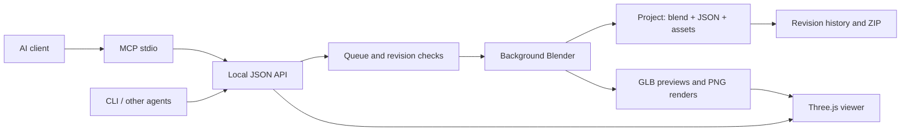

# Architecture and roadmap

Research date: October 17, 2026. Goal: a local, AI-friendly 3D pipeline for Windows 10/11, running without Blender's main window, with model import, persistent projects, and a human inspection window.

## Architecture decision

**A small control service + headless Blender + MCP/JSON interfaces + a separate WebGL viewer.** This is a practical initial architecture for these requirements, balancing pipeline coverage, maintainability, and time to a usable implementation. It is an engineering choice, not a claim of universal superiority.

Blender supports background operation and command-line automation. Reusing its engine avoids rebuilding mesh authoring, animation, and rendering from scratch. [Blender CLI documentation](https://docs.blender.org/manual/en/5.1/advanced/command_line/render.html).

| Alternative | Strength | Decision |
|---|---|---|
| Custom C++/Rust engine | Full control over size, memory, and commands | Too much work before reaching broad pipeline coverage; consider only for measured specialized bottlenecks |
| Separate background Blender process | Existing pipeline, independent of the service's Python ABI | Selected: each job runs in an isolated process and publishes a successful revision |
| Blender as a `bpy` Python module | Direct calls without a CLI bridge | Possible later; adds build compatibility and shares the host process's failure domain. [Official documentation](https://docs.blender.org/api/main/info_advanced_blender_as_bpy.html) |
| Existing Blender MCP addon | Quick control of an interactive installation | Evaluated [MCP for Blender](https://github.com/ahujasid/mcp-for-blender); its documented workflow uses an open Blender instance and addon. This project needs its own queue, storage, and viewer |
| OpenUSD + Hydra | Large-scene composition and interchange | A future large-project format; authoring requires additional components. [OpenUSD introduction](https://openusd.org/release/intro.html) |
| Godot | Interactive scenes, game logic, headless execution | A potential interactive export target, rather than the initial authoring backend. [Godot CLI](https://docs.godotengine.org/en/4.5/tutorials/editor/command_line_tutorial.html) |
| FreeCAD | Parametric design of physical objects | A future CAD backend for STEP/BREP. [FreeCAD features](https://www.freecad.org/features.php?lang=us) |
| Three.js alone | Small browser interface and fast display | Selected for inspection; authoring and final rendering remain in Blender. [GLTFLoader](https://threejs.org/docs/pages/GLTFLoader), [OrbitControls](https://threejs.org/docs/pages/OrbitControls.html) |

## Agent interface

MCP provides discoverable tools, schemas, and image responses. Local stdio avoids a public protocol endpoint. The application logic lives in a JSON API so non-MCP agents and ordinary programs can use the same engine. The protocol adapter uses the [official MCP SDK](https://py.sdk.modelcontextprotocol.io/run/).

Design principles: batch mutations, stable object IDs, explicit units, validation before execution, immediate job IDs, details on demand, optimistic revision checks, and a render-inspect-correct loop. Python is an extension mechanism, not a substitute for well-defined operations.

## Phase 1: working foundation — implemented

- [x] Local service, Blender discovery, and hidden Windows startup.
- [x] Validated geometry, materials, hierarchies, camera, lights, and animation keyframes.
- [x] Single-worker queue, job IDs, logs, stages, cancellation, and timeouts.
- [x] Independent Blender processes, successful revision publication, and revision restore.
- [x] MCP stdio, JSON API, CLI, and native image responses to AI.
- [x] Orbit, zoom, pan, timeline, revision selection, and object inspection.
- [x] GLB/glTF, OBJ, STL, and FBX imports with copied source assets.
- [x] `.blend`, `.glb`, PNG, persistent projects, and ZIP save/open.
- [x] Demo, launch scripts, documentation, automated tests, and visual checks.
- [x] English-only application-owned interface, source comments, documentation, and examples.

Acceptance: an agent can create a project, build/import a model, animate, render, inspect, edit, save, and reopen it without driving Blender's UI. Test evidence and compatibility boundaries are recorded in [VALIDATION.md](docs/VALIDATION.md).

## Phase 2: modeling and materials

Priority: make common tasks available through typed tools instead of arbitrary Python.

- Boolean, array, remesh, extrusion, inset, and loop cuts with stable selectors; topology, normals, manifold, and dimension checks.
- Curves, text, and reusable parametric recipes for objects, rooms, and mechanical parts.
- [x] Image texture slots, explicit per-corner UVs, smart unwrap, high-to-low baking, packed textures, FBX, and game-asset QA (0.2).
- [ ] Interactive seam editing/painting, advanced PBR graphs, and UV overlap/stretch analysis.
- Typed Geometry Nodes graphs with socket and version validation.
- Bulk instancing and object queries that reduce agent context requirements.
- Multi-view contact sheets, object masks, bounding boxes, and visual feedback for vision models.

Acceptance: 20 reference modeling tasks succeed through typed tools; failures identify affected objects, fields, and actionable corrections.

## Phase 3: animation pipeline

- Armatures, skin weights, IK/FK, constraints, poses, clips/NLA, and blend shapes.
- Baking for rigid bodies, cloth, particles, and fluids with separate caches and reproducible seeds.
- Shots, cameras, compositing, frame sequences, FFmpeg video encoding, and audio.
- USD/Alembic/FBX/STL export with an explicit feature support matrix.
- Character assets and rig templates with license tracking.

Version 0.1 does not provide finished specialized APIs for these features. Many are reachable through trusted `bpy`, but require implementation and scenario-specific tests. GLB cannot represent every Blender capability.

## Phase 4: performance and resource control

- Benchmark cold/warm startup, large scenes, RAM/VRAM, and queues across 1/10/100 projects.
- Use measurements to decide whether small mutations need a persistent Blender worker with rollback; retain process isolation for rendering and risky operations.
- Content-addressed caches for assets, geometry, and textures; revision deltas instead of full `.blend` copies.
- Configurable CPU threads and GPU backend, plus Windows Job Objects for process-tree termination and resource limits.
- Debounced intermediate previews, event notifications instead of polling, and viewer FPS limits.
- Explicit history retention and archiving policies with user-controlled deletion.

The initial control layer has no Electron runtime, mandatory cloud service, or constantly resident Blender. This does not make Blender itself small or bound the memory cost of complex scenes. An open WebGL viewer consumes GPU resources.

## Phase 5: distribution and integration

- Portable bundles with Python runtime and required JS assets, then a signed Windows installer.
- A validation matrix for Windows 10/11, GPUs, Blender LTS, and Python versions.
- Optional WebView2 desktop host if the browser window proves insufficient.
- Remote MCP Streamable HTTP with authentication, auditing, and workspace restrictions; do not expose the current local API publicly.
- Backend plugins: FreeCAD for CAD, USD for large scenes, and Godot for interactive exports.
- Optional text/image-to-3D adapters with explicit licenses and resource requirements.
- Versioned project format, migrations, and packaging of simulation caches and script-generated assets.

Acceptance: a clean Windows 10/11 installation can run the package, import reference projects, and pass its tests without manual development-environment setup.

## Explicit boundaries

An AI requires a tool-capable host; a cloud-only host needs a local bridge. Three.js and Cycles are not expected to match pixel-for-pixel. Full Blender feature coverage is not considered complete merely because `bpy` execution exists. Windows login startup, non-local networking, automatic GPU setup, and background updates are not enabled implicitly.

Prioritize validated operations and reference scenes, then optimize measured bottlenecks. The agent must be able to understand outcomes and continue a project after errors.
