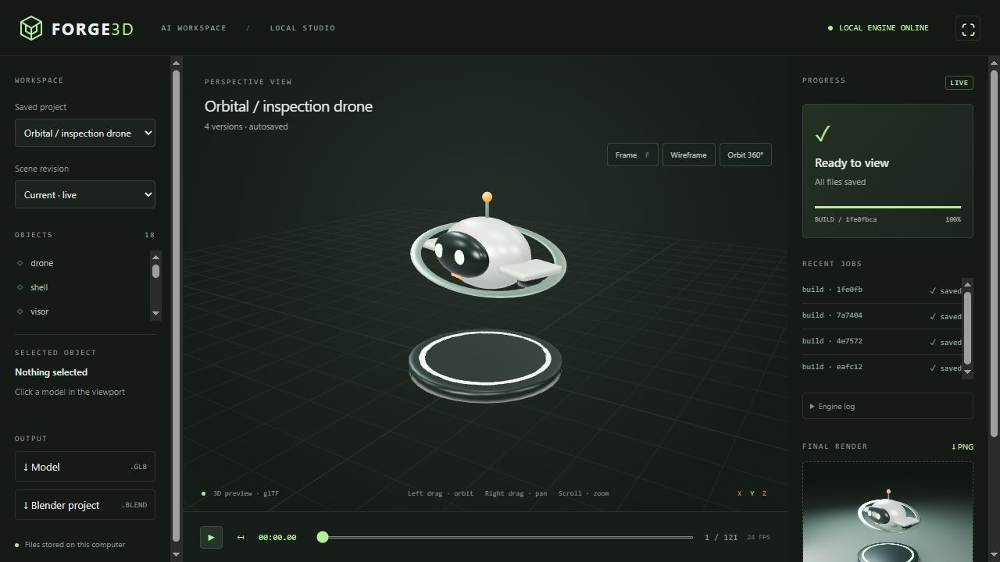

# Forge3D AI

**A local 3D workspace for AI agents, with headless Blender and a live human viewer.**

Build models, import assets, animate scenes, render images, and save versioned projects through MCP or a JSON API. Blender runs in the background; the browser viewer lets you inspect the results without interrupting the agent.



## Features

- **AI control:** 16 MCP tools, validated JSON schemas, HTTP API, and CLI.
- **Modeling:** primitives, custom meshes, object hierarchies, and common modifiers.
- **Look development:** PBR materials, camera, lighting, and Cycles/Eevee rendering.
- **Animation:** transform keyframes, GLB animation playback, and PNG frame sequences.
- **Import:** GLB/glTF, OBJ with MTL, STL, and FBX, with supported dependencies copied into the project.
- **Export:** GLB models, native `.blend` files, PNG renders, and project ZIP archives.
- **Persistence:** autosave, revision history, restore, and portable project reopening.
- **Viewer:** orbit, pan, zoom, wireframe, timeline, job progress, logs, and render preview.

## Quick start on Windows

Requires **Python 3.11+**, an installed or portable **Blender**, and **Node.js/npm** to prepare the viewer. Node.js is unnecessary when installing a source bundle that already includes the prepared viewer files.

```powershell
git clone https://github.com/Darin-Ziloy/forge3d-ai.git
cd forge3d-ai
.\Setup.ps1
.\Start-Forge3D.cmd
```

Open [localhost:8765](http://127.0.0.1:8765). Run `Start-Demo.cmd` to generate an animated inspection drone and a render. Use `Stop-Forge3D.cmd` to stop the background service.

If Blender is not found automatically, set its path before starting:

```powershell
$env:BLENDER_PATH = 'D:\Tools\Blender\blender.exe'
.\.venv\Scripts\python.exe -m forge3d start
```

**Viewer controls:** left drag to orbit, right drag to pan, scroll to zoom, and **F** to frame the model.

## Connect your AI

Setup generates a local `mcp-config.json`. Add its `mcpServers.forge3d` entry to your MCP client's configuration. To regenerate it:

```powershell
.\.venv\Scripts\python.exe -m forge3d mcp-config
```

The MCP server uses **stdio** and starts the shared local service on demand. Your AI host must support MCP tools; cloud-only clients need a local bridge. Agents without MCP can use the [JSON API](docs/API.md) or CLI.

Example request: *"Create a desk lamp with a metal stand and a matte green shade. Animate a turn over 120 frames, render the first frame, and save the project."*

## Import and save projects

```powershell
.\.venv\Scripts\python.exe -m forge3d create 'My project'
.\.venv\Scripts\python.exe -m forge3d import PROJECT_ID 'C:\Models\robot.glb'
.\.venv\Scripts\python.exe -m forge3d save PROJECT_ID
.\.venv\Scripts\python.exe -m forge3d open 'C:\Archives\project.zip'
```

Import returns an asset reference. Place it in a scene with an object of type `import`; see the [user guide](docs/GUIDE.md#importing-models). Every successful build is already autosaved. ZIP archives provide portable copies with assets and revision history. The viewer currently downloads outputs; model import is performed through MCP or CLI.

## Status and scope

**Version 0.1.0 is a working prototype**, using Blender as its 3D engine. It is not a complete replacement for Blender's authoring tools. Typed operations cover the basic pipeline; advanced `bpy` scripting is an explicit opt-in for trusted agents.

Tested on **Windows 10, Python 3.14.4, and Blender 5.2.2 LTS**. Windows 11 is a target platform and has not yet been separately verified. [Validation report](docs/VALIDATION.md).

Current limits include one worker at a time, CPU rendering by default, no standard FBX/OBJ/STL export commands, no import button in the viewer, and no remote MCP endpoint. Rigging, UV tools, simulations, and GPU selection are on the [roadmap](PLAN.md).

## Documentation

- [User guide](docs/GUIDE.md): installation, MCP workflow, imports, persistence, and advanced mode.
- [API reference](docs/API.md): endpoints, authentication, job states, and examples.
- [Architecture and roadmap](PLAN.md).
- [Development and contributing](CONTRIBUTING.md).
- [Validation](docs/VALIDATION.md) and [third-party notices](THIRD_PARTY.md).

## License

Forge3D source code is **[GPL-3.0-or-later](LICENSE)**. Blender is installed separately. Third-party components retain their licenses. This project is independent and is not affiliated with the Blender Foundation.
