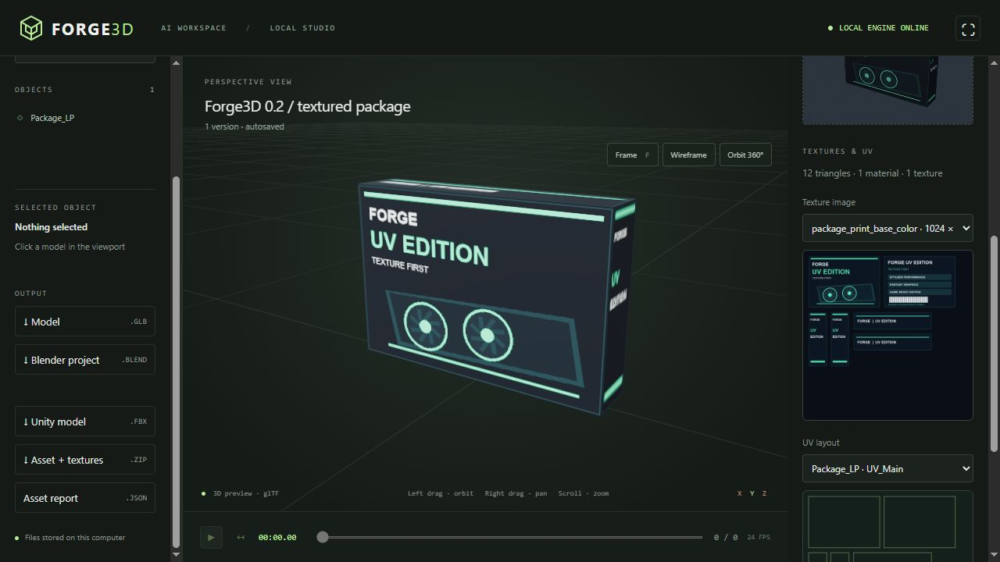

# Textures, UVs, and low-poly game props

Forge3D 0.2 supports the texture-first and high-to-low workflows through the normal scene API/MCP. Trusted Python is **not required** for these operations. Existing solid-color scenes remain valid. The browser uses GLB materials and embedded textures; it also displays the saved texture images, UV layouts, geometry counts, and download links.



## Texture-first workflow

1. Generate original atlas artwork outside Blender, using Pillow or an authorized PNG/JPEG. Keep printed graphics, labels, vents, barcodes, and small surface details in the atlas. Geometry should describe the silhouette and volume.
2. Call `import_asset(project_id, source_path)` for the image. The returned `asset` is a project-relative reference; no absolute filenames belong in the scene JSON. The project copies the file so later edits to the original do not change a revision.
3. Define a texture-backed material and mesh UVs, then call `build_scene`. Read `capabilities` for the current schema.
4. Poll `job_status`. Inspect the render with `view_render`, the atlas with `view_texture`, and the geometry/texture report in `inspect_project.manifest.asset_report`.
5. Download `asset_bundle.zip` for the exported model, texture PNGs, UV SVGs, scene recipe JSON, report, and build renders. Use `save_project_archive` for complete editable project history and source assets.

```json
{
  "id": "print",
  "roughness": 0.85,
  "base_color_texture": {"asset": "RETURNED_ASSET_ID/Box_Albedo.png", "uv_map": "UV_Main"}
}
```

Available slots: `base_color_texture`, `normal_texture`, `roughness_texture`, `metallic_texture`. Each takes an asset, `uv_map` (default `UVMap`), `interpolation` (`Linear` or `Closest`), and `extension` (`REPEAT`, `EXTEND`, `CLIP`). `normal_strength` defaults to 1. Albedo uses sRGB; the other maps use Non-Color. Normal maps are tangent-space, +Y/OpenGL. Scalar maps use grayscale input; glTF export packs roughness/metallic as needed. An albedo image replaces the solid `color`; opaque materials are the supported texture profile. Texture dimensions are limited to 8192 per side; prefer 512–1024 for small props.

## UV modes

Every mesh object has an optional `uv` specification:

- `{"mode":"preserve"}` (default): retain primitive/imported UVs. Custom meshes need explicit or generated UVs before using image materials.
- `{"mode":"smart","name":"UVMap","angle_limit":66,"island_margin":0.02}`: Blender Smart UV Project with a fractional island margin. Useful for baked relief and general props; does not place preprinted artwork on specific sides.
- `{"mode":"explicit","name":"UV_Main","coordinates":[...]}`: one UV pair per face corner, in exactly the order of the object's `faces`. Available for custom `type:"mesh"` objects. UV origin is bottom-left. Different corners sharing a vertex can have different UVs (seams).

For a quad `faces:[[0,1,2,3]]`, use `coordinates:[[[0,0],[1,0],[1,1],[0,1]]]`. Multiple UV islands can occupy different atlas regions. Coordinates outside 0–1 support tiling. The API validates face/corner counts and finite numbers. Builds reject missing UV maps and collapsed UV faces on image-textured meshes. SVG layouts show the evaluated active UV layer; inspect seams, orientation, and distortion visually. Automatic overlap/stretch certification is not implemented.

## Using casual-lowpoly-props

The skill's original Forge3D compatibility note describes **0.1**. For 0.2, use this standard API path instead of enabling `--allow-python`:

```powershell
$PropSkill = "$env:USERPROFILE\.agents\skills\casual-lowpoly-props"
# Pillow is an optional atlas-authoring dependency outside Blender.
.\.venv\Scripts\python.exe -m pip install Pillow
.\.venv\Scripts\python.exe "$PropSkill\scripts\generate_package_atlas.py" --out output\Box_Albedo.png --brand FORGE --product "UV EDITION" --size 1024
.\.venv\Scripts\python.exe scripts\create_textured_example.py --atlas output\Box_Albedo.png --layout output\Box_Albedo.json
```

The adapter reads the skill's six panel rectangles (pixel origin top-left), converts them to per-corner UVs with a one-texel inset, and creates **one 12-triangle box, one material, and one atlas**. It also creates FBX, GLB, packed BLEND, a render, report, and portable project ZIP. No geometry lettering or extra decal planes are used. Keep the original art generator/recipe separately for editing; project archives retain the actual copied image and declarative geometry/UV recipe.

For custom recipes, construct the same scene fields through MCP, or run the skill's existing Blender runner and import its textured GLB. Arbitrary `def build()` scripts cannot run through a declarative schema; the direct runner remains useful for features outside the typed API. Imported GLB/FBX materials and UVs remain intact unless an explicit material override or UV operation is requested. A white asset with no image materials will not acquire artwork merely by being imported: generate/assign its textures or reimport the textured source.

## High-to-low baking

Use individual declarative meshes for sources and targets. Targets must have final topology (no modifiers), valid UVs, and spatial alignment with the sources. High sources can have bevel/subdivision modifiers. All high source objects are removed after all bake passes and before QA/export; JSON retains them for reproducible rebuilding.

```json
{
  "objects": [
    {"id":"Crate_LP","type":"cube","smooth":false,"uv":{"mode":"smart"}},
    {"id":"Crate_HP","type":"cube","smooth":false,"modifiers":[{"type":"bevel","amount":0.08}]}
  ],
  "bakes": [{"low":"Crate_LP","high":["Crate_HP"],"mode":"both","size":1024,"margin":16,"cage_extrusion":0.2}],
  "export_fbx": true
}
```

Modes are `albedo`, `normal`, `both`. Sizes: 128, 256, 512, 1024, 2048. The worker uses Cycles CPU selected-to-active baking; albedo contains diffuse color without lighting, normal is tangent-space. Each target receives a new independent material with the baked maps; scalar defaults are metallic 0 and roughness 0.55. A normal-only bake does not copy the high source's albedo. Tune `cage_extrusion` and `max_ray_distance` to avoid missed rays. Inspect the actual maps and render: successful operator execution does not prove every texel projected correctly. Failed baking preserves the previous revision.

## QA and export

Set `asset_checks` to `{"target_use":"packaging","max_tris":100}` for printed packaging. A successful result must have 1–2 meshes, 1–2 materials, an albedo UV texture on every mesh, and stay within the evaluated triangle budget. `general` applies only the supplied triangle budget. Reports are produced even when these optional strict checks are omitted. Draw-call counts are estimates, not profiler measurements. Image dimensions and color spaces, UV layer names, and collapsed UV faces are reported.

- `preview.glb`: embedded images and UVs; browser material preview and interchange.
- `scene.blend`: packed images and the final scene, with relative PNG paths.
- `scene.fbx`: optional (`export_fbx:true`), meshes only, -Z forward / Y up, embedded textures. Unity may need manual material setup, especially URP/HDRP or roughness maps. Unity itself is not automatically tested.
- `Textures/*.png`: independent PNG copies of used image textures.
- `UV/*.svg`: per-object evaluated active UV layouts.
- `asset_report.json`: geometry, UV, material, and texture inventory.
- `asset_bundle.zip`: all of the above plus available build renders and declarative scene.

Old saved revisions keep their original outputs. Rebuild a scene or restore a revision to produce the new reports/downloads. Separate render jobs do not retroactively update an existing asset bundle. Hand-painted strokes, interactive seam editing, arbitrary node graphs, displacement, UDIMs, and rigging are not part of this texture profile.

The implementation uses Blender's [UV operators](https://docs.blender.org/api/current/bpy.ops.uv.html) and [bake operator](https://docs.blender.org/api/current/bpy.ops.object.html#bpy.ops.object.bake).
